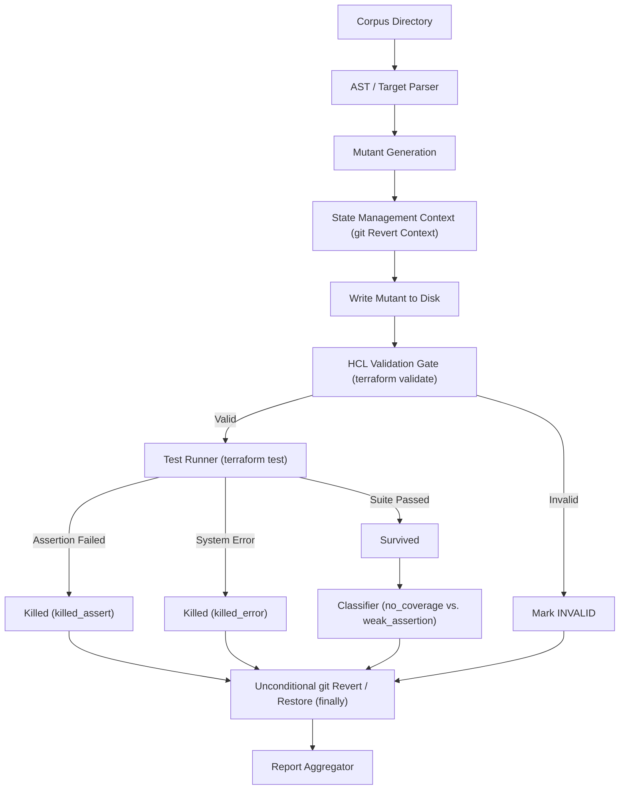

# Evaluation Report: Mutation Testing for Infrastructure-as-Code

This report presents the design, implementation, and empirical evaluation of `tfmutate`, a mutation testing tool for Terraform HCL configurations, evaluated across a corpus of 23 real-world repositories.

---

# Introduction

Infrastructure-as-Code (IaC) has become the standard for provisioning modern cloud systems, treating infrastructure declarations with the same software engineering practices as application code. As IaC codebases grow in complexity and criticality, verifying their correctness is essential to prevent catastrophic outages, security breaches, and cost overruns.

Traditionally, testing IaC has been slow, expensive, and flaky due to its reliance on real cloud provider APIs. The introduction of native testing frameworks with mock provider capabilities (like `terraform test` in Terraform v1.7+) has enabled developers to write fast, isolated unit tests. However, the presence of a test suite does not guarantee its quality. If assertions are missing or shallow, tests may pass green even if the underlying infrastructure configuration is severely broken.

Mutation testing (fault injection) is a well-established technique in traditional software engineering to measure test suite adequacy. By programmatically introducing small syntactic changes (mutants) into the source code, mutation testing measures whether a test suite is strong enough to fail (kill) the modified code. If a mutant survives, it exposes a coverage gap or a weak assertion.

This paper presents the design, implementation, and empirical evaluation of `tfmutate`, the first mutation testing tool designed specifically for Terraform configurations. We evaluate `tfmutate` across a diverse corpus of 23 real-world Terraform modules, analyzing the effectiveness of HCL test suites in catching security, resource, and compliance faults.

---

# Mutation Operators for IaC

To evaluate test effectiveness, `tfmutate` implements an operator catalog of 12 distinct fault injection operations across security, resource provisioning, and compliance categories. 

A critical methodological distinction is made between **CORPUS-validated** operators (which successfully generated valid, runnable mutants in the real corpus) and **FIXTURE-validated** operators (which are syntactically valid and unit-tested but did not generate scored mutants in the active corpus).

| Operator ID | Category | Scoped Attribute Synonyms | Enclosing Resource Type Scope | Target Surface | Original → Mutated | Validation Status |
| :--- | :--- | :--- | :--- | :---: | :--- | :---: |
| `MUT-SEC-001` | security | `acl` | `aws_s3_bucket`, `aws_s3_bucket_acl` | R | `"private"` → `"public"` | **FIXTURE** |
| `MUT-SEC-002` | security | `encrypted`, `storage_encrypted` | `aws_ebs_volume`, `aws_db_instance`, etc. | R | `true` → `false` | CORPUS |
| `MUT-SEC-003` | security | `cidr_block`, `cidr_blocks` | `aws_security_group`, `aws_security_group_rule` | R | restrictive CIDR → `"0.0.0.0/0"` | **FIXTURE** |
| `MUT-SEC-004a` | security | `block_public_acls` | `aws_s3_bucket_public_access_block` | R | `true` → `false` | CORPUS |
| `MUT-SEC-004b` | security | `block_public_policy` | `aws_s3_bucket_public_access_block` | R | `true` → `false` | CORPUS |
| `MUT-SEC-004c` | security | `ignore_public_acls` | `aws_s3_bucket_public_access_block` | R | `true` → `false` | CORPUS |
| `MUT-SEC-004d` | security | `restrict_public_buckets` | `aws_s3_bucket_public_access_block` | R | `true` → `false` | CORPUS |
| `MUT-RES-001` | resource | `instance_type`, `instance_class`, etc. | `aws_instance`, `aws_db_instance`, etc. | R, V | small size → representative XL | CORPUS |
| `MUT-RES-002` | resource | `count`, `desired_count`, `min_size` | any (meta-arg) / autoscaling resources | R, V | int ≥ 2 → `1` | CORPUS |
| `MUT-RES-003` | resource | `replicas`, `replica_count`, `min_replicas` | k8s/helm & scaling resources | R, V | int ≥ 1 → `0` | CORPUS |
| `MUT-TAG-001` | compliance | `env`, `environment`, `Environment` | tags maps / any | R, V, L | `"production"`/`"prod"` → `"dev"` | CORPUS |
| `MUT-TAG-002` | compliance | `team`, `owner`, `cost_center` | tags maps (scoped) | R, L | delete attribute | **FIXTURE** |

## Fixture-Validated-Only Operators and the Disjointness Finding

Three operators are classified as fixture-validated-only and did not contribute scored data to the empirical results:

1. **`MUT-SEC-001` (S3 ACLs)** and **`MUT-SEC-003` (Restrictive CIDRs)**:
   * *The Disjointness Finding:* A major empirical finding of this research is the structural disjointness between modern IaC testing adoption and legacy configuration patterns. In an authenticated GitHub code search of 46 test-equipped Cohort-A repositories, **zero** used `acl = "private"` or hardcoded security group CIDRs. In a broader search of 86 public repositories containing `acl = "private"`, **zero** utilized the native `.tftest.hcl` framework.
   * *Enum-Value Validation Constraints:* In the two cases where `acl = "private"` was structurally present in our corpus (`platform-tools` and `terraform-aws-static-site`), mutating `"private"` to `"public"` failed static `terraform validate` because `"public"` is not a valid canned ACL in the AWS provider schema. This demonstrates that standard regex string replacement operators fail to account for provider-specific HCL validation constraints, rendering textbook mutations statically invalid.
2. **`MUT-TAG-002` (Delete Required Tag)**:
   * *Missing Attribute Target:* This operator deletes metadata keys (`"team"`, `"owner"`, or `"cost_center"`) inside `tags` or `labels` maps. It generated zero scored mutants in this corpus. A case-insensitive audit across the scored repositories confirmed that tag keys such as `Owner = var.owner` (in `serverless-architecture-patterns`) and `CostCenter = var.cost_center` (in `aws-platform-starter`) exist. However, because `tfmutate` matches attributes case-sensitively using a raw regex compiler (`owner|team|cost_center` without `re.IGNORECASE`), these capitalized assignments were not matched. No lowercase assignments of `"team"`, `"owner"`, or `"cost_center"` keys exist inside any active, scored HCL files in the corpus. **This case-sensitivity mismatch is accepted as a known limitation for this version of the tool rather than being patched, as it serves as a valuable empirical illustration of the limitations of regular-expression-based target matching compared to a full schema-aware AST parser.**

---

# Tool Design

The `tfmutate` tool implements the complete mutation testing cycle for HCL configurations. Its architecture is divided into three key stages: AST parsing and target discovery, mutation application, and test execution/classification.



## 1. Synonym-Based, Resource-Scoped Matching
The parser matches target sites using regular expressions scoped to specific enclosing resource types (e.g., matching `block_public_acls` only within `aws_s3_bucket_public_access_block` blocks). This prevents mutating unrelated attributes of the same name. For variables (V) and local maps (L), where no enclosing block scope is present, matching falls back to token boundary boundaries matching the synonym set (e.g. matching `cost_center` but avoiding `cost_center_id`).

## 2. NO_OP Static Override Detection
Mutants generated on variable defaults (V surface) are functionally inert if the corresponding `.tftest.hcl` test file overrides that variable inside its `run` blocks. Because dynamic test execution cannot distinguish an overridden default from a passing test, `tfmutate` performs static override detection: it parses `.tftest.hcl` configurations, identifies overridden variables, and marks their mutants as `no_op` to prevent them from inflating survival counts.

## 3. Content-Based Module-Root Resolution
To support complex multi-module repositories, `tfmutate` implements a module-root resolution algorithm. Rather than assuming tests are placed at the root, the tool recursively scans HCL configuration contents to find directories containing active `.tftest.hcl` files and resolves module structures dynamically.

## 4. Multi-Engine Support and Version Pinning
The execution engine supports both standard HashiCorp Terraform and OpenTofu. To prevent drift in parsing rules or test output formatting, `tfmutate` checks and enforces independent version pinning at runtime (e.g., verifying `tofu` at `1.15.7`), guaranteeing execution safety and consistency.

## 5. State Management and Safety
To prevent leaving directories in a corrupted state after execution or mid-run crashes, `tfmutate` wraps the mutation cycle in a context manager. It records the original state of the target file, writes the mutation, runs validation and testing, and unconditionally reverts the file to its clean git state inside a `finally` block.

---

# Empirical Study

This section presents the quantitative findings from the mutation testing batch run executed across the corpus of 23 reusable Terraform configurations. The dataset comprises a total of 242 generated mutants, of which 177 were valid, runnable, and scored. 

## 1. Tooling and Validation Methodology
The mutation execution was performed using the `tfmutate` CLI harness. The pipeline strictly gates each module run: first verifying that the unmutated test suite passes cleanly (the green-baseline gate), then applying mutations, running static HCL validation, and finally executing the native `terraform test` suite.

As a matter of configuration alignment for static validation, we disclose the following bounded setup exception:
> *A minimal `providers.tf` was added to `terraform-aws-static-site` to satisfy a caller-supplied provider alias (`aws.us_east_1`) the module expects by design, enabling standalone `terraform validate` to execute successfully during mutation testing; no other repository in the corpus received any source modification.*

---

## 2. Aggregate and Category-Level Results

Across all repositories, the overall mutation score is **24.9%** (44 of 177 scored mutants killed), with a 95% Wilson confidence interval of **[19.1%, 31.7%]**. 

When disaggregated by operator category, a stark variance in testing effectiveness is revealed between security, resource, and compliance domains:

| Category | Scored Mutants (n) | Killed (k) | Mutation Score | 95% Wilson CI |
| :--- | :---: | :---: | :---: | :---: |
| **Overall** | **177** | **44** | **24.9%** | **[19.1%, 31.7%]** |
| **Compliance** | 7 | 0 | 0.0% | [0.0%, 35.4%] |
| **Resource** | 49 | 5 | 10.2% | [4.4%, 21.8%] |
| **Security** | 121 | 39 | 32.2% | [24.6%, 41.0%] |

* **Security Mutants** ($n=121$) exhibit the highest kill rate at **32.2%** (95% Wilson CI: [24.6%, 41.0%]). However, as detailed in Section 5, this rate is heavily influenced by a high concentration of kills in just two repositories (`platform-design` and `platform-tools`), rather than reflecting a uniform practitioner trend across the entire corpus.
* **Resource Mutants** ($n=49$) exhibit a low kill rate of **10.2%** (95% Wilson CI: [4.4%, 21.8%]).
* **Compliance Mutants** ($n=7$) exhibit a **0.0%** kill rate (95% Wilson CI: [0.0%, 35.4%]). While the raw number of scored compliance mutants is thin, it highlights a broader trend: standard assertions rarely validate tag presence or metadata compliance under mutated inputs.

---

## 3. Operator-Level Analysis and the Sizing Assertions Finding

Analyzing the data at the individual operator level highlights which specific fault patterns are actively validated by practitioners:

| Operator ID | Category | Scored (n) | Killed (k) | Mutation Score | 95% Wilson CI |
| :--- | :--- | :---: | :---: | :---: | :---: |
| `MUT-RES-001` | resource | 25 | 0 | 0.0% | [0.0%, 13.3%] |
| `MUT-RES-002` | resource | 12 | 1 | 8.3% | [1.5%, 35.4%] |
| `MUT-RES-003` | resource | 12 | 4 | 33.3% | [13.8%, 60.9%] |
| `MUT-SEC-002` | security | 5 | 4 | 80.0% | [37.6%, 96.4%] |
| `MUT-SEC-004a` | security | 29 | 9 | 31.0% | [17.3%, 49.2%] |
| `MUT-SEC-004b` | security | 29 | 13 | 44.8% | [28.4%, 62.5%] |
| `MUT-SEC-004c` | security | 29 | 6 | 20.7% | [9.8%, 38.4%] |
| `MUT-SEC-004d` | security | 29 | 7 | 24.1% | [12.2%, 42.1%] |
| `MUT-TAG-001` | compliance | 7 | 0 | 0.0% | [0.0%, 35.4%] |

### The Sizing Assertion Coverage Gap (`MUT-RES-001`)
The most statistically significant single finding in the operator-level dataset is the performance of **`MUT-RES-001`** (which mutates instance types/classes to oversized alternatives). 
* With $n=25$ scored mutants, **zero were killed ($k=0$)**, resulting in a mutation score of **0.0%** with a tight 95% Wilson confidence interval of **[0.0%, 13.3%]**. 
* Because of the relatively high sample size and narrow interval, this represents a strong coverage gap in the analyzed corpus.
* Within this corpus specifically, although instance types are parameterized and declared, no test suite contains assertions verifying compute or database sizing configurations under test execution. However, this finding is heavily influenced by the fact that 18 of the 25 scored sizing mutants (72.0%) originate from a single repository (`aws-platform-starter`), meaning this coverage gap is concentrated in a single large test suite rather than generalizable across all modules.

---

## 4. Survived-Mutant Classification

For the 133 valid mutants that survived execution, the classifier categorized the failure mode to understand whether survival was caused by a total lack of test execution or by weak assertions:

| Category | Total Survived | no_coverage | weak_assertion | plan_only_no_assert |
| :--- | :---: | :---: | :---: | :---: |
| **Compliance** | 7 | 7 | 0 | 0 |
| **Resource** | 44 | 44 | 0 | 0 |
| **Security** | 82 | 53 | 29 | 0 |
| **Total** | **133** | **104** | **29** | **0** |

* **`no_coverage`** (104/133, **78.2%** of survivals): The target resource or attribute mutated was completely unreferenced by the test assertions. This represents a total absence of test cases verifying the component.
* **`weak_assertion`** (29/133, **21.8%** of survivals): The test suite actively asserted on the resource containing the mutation, but evaluated other attributes (e.g., verifying S3 public access block resources but failing to assert on all security boolean flags), allowing the mutation to pass undetected.
* **`plan_only_no_assert`** (0/133, **0.0%** of survivals): No test cases ran purely to dry-run plans without incorporating assertion blocks.

This attribution is confirmed by cross-tabulating survived mutants by operator and survival reason:

| Operator ID | Category | no_coverage | weak_assertion |
| :--- | :--- | :---: | :---: |
| `MUT-RES-001` | resource | 25 | 0 |
| `MUT-RES-002` | resource | 11 | 0 |
| `MUT-RES-003` | resource | 8 | 0 |
| `MUT-SEC-002` | security | 1 | 0 |
| `MUT-SEC-004a` | security | 13 | 7 |
| `MUT-SEC-004b` | security | 13 | 3 |
| `MUT-SEC-004c` | security | 13 | 10 |
| `MUT-SEC-004d` | security | 13 | 9 |
| `MUT-TAG-001` | compliance | 7 | 0 |

As shown, all 29 weak assertions occurred exclusively within the `MUT-SEC-004a`–`MUT-SEC-004d` operators (targeting S3 public access block configuration flags). In contrast, the single survived mutant for `MUT-SEC-002` (storage encryption) was due to a total lack of assertion coverage (`no_coverage`).

---

## 5. Score Concentration and Dataset Characteristics

A critical characteristic of the empirical data is its **high concentration** across a few select repositories, rather than being uniformly distributed across the corpus:

* **Zero-Mutant Repositories**: **9 of the 23 repositories** in the corpus (`terraform-aws-compliance`, `terraform-aws-lb`, `terraform-aws-oidc-github`, `terraform-aws-security-group`, `terraform-aws-vpc`, `terraform-datadog-users`, `terraform-postgres-config-dbs-users-roles`, `conf-data-processing-architecture-reference`, and `terraform-duplocloud-components`) contributed **zero scored mutants**. 
  * The first 7 directories generated zero mutants because their configurations are fully parameterized with no literal targets matching our operator patterns.
  * The latter 2 repositories failed baseline execution due to unresolvable submodules or external authentication requirements.
* **Skewed Kill Distribution**: Of the 44 total kills recorded in the corpus, **22 (exactly 50.0%)** were generated by just two repositories:
  1. **`platform-design`** (13 kills)
  2. **`platform-tools`** (9 kills)
* **Operator-Level Mutant Concentration**: The scored populations for specific operators are also highly concentrated:
  - For `MUT-RES-001` (sizing mutations), **18 of the 25 scored mutants (72.0%)** were generated from a single repository: `aws-platform-starter`.
  - For `MUT-TAG-001` (tagging mutations), **6 of the 7 scored mutants (85.7%)** were generated from a single repository: `terraform-aws-static-site`.

This concentration represents a major skew in the dataset where half of the tested configurations contributed no information to the score, and half of the successful kills were concentrated in two suites. This skew is analyzed in detail under the threats to validity section.

---

## 6. Per-Repository Granular Metrics

The complete, per-repository dataset aggregated into `master.csv` is detailed below:

| Repository | Total Mutants | Baseline Fail | Invalid | Scored (n) | Killed (k) | Mutation Score | 95% Wilson CI |
| :--- | :---: | :---: | :---: | :---: | :---: | :---: | :---: |
| `aws-platform-starter` | 38 | 0 | 0 | 38 | 5 | 13.2% | [5.8%, 27.3%] |
| `aws-terraform-infrastructure` | 5 | 0 | 0 | 5 | 4 | 80.0% | [37.6%, 96.4%] |
| `cloud-native-deployment-platform` | 1 | 0 | 0 | 1 | 1 | 100.0% | [20.7%, 100.0%] |
| `conf-data-processing-architecture-reference` | 20 | 20 | 0 | 0 | 0 | n/a | n/a |
| `eks-vulnerable-infra` | 5 | 0 | 0 | 5 | 2 | 40.0% | [11.8%, 76.9%] |
| `genai-idp-terraform` | 12 | 4 | 0 | 8 | 0 | 0.0% | [0.0%, 32.4%] |
| `platform-design` | 59 | 26 | 1 | 32 | 13 | 40.6% | [25.5%, 57.7%] |
| `platform-tools` | 38 | 0 | 1 | 37 | 9 | 24.3% | [13.4%, 40.1%] |
| `psoxy` | 11 | 2 | 0 | 9 | 0 | 0.0% | [0.0%, 29.9%] |
| `server-terraform` | 7 | 1 | 1 | 5 | 0 | 0.0% | [0.0%, 43.4%] |
| `serverless-architecture-patterns` | 19 | 0 | 0 | 19 | 4 | 21.1% | [8.5%, 43.3%] |
| `terraform-aws-compliance` | 0 | 0 | 0 | 0 | 0 | n/a | n/a |
| `terraform-aws-lb` | 0 | 0 | 0 | 0 | 0 | n/a | n/a |
| `terraform-aws-oidc-github` | 0 | 0 | 0 | 0 | 0 | n/a | n/a |
| `terraform-aws-security-group` | 0 | 0 | 0 | 0 | 0 | n/a | n/a |
| `terraform-aws-sonarqube` | 2 | 0 | 0 | 2 | 1 | 50.0% | [9.5%, 90.5%] |
| `terraform-aws-static-site` | 11 | 0 | 1 | 10 | 0 | 0.0% | [0.0%, 27.8%] |
| `terraform-aws-vpc` | 0 | 0 | 0 | 0 | 0 | n/a | n/a |
| `terraform-datadog-users` | 0 | 0 | 0 | 0 | 0 | n/a | n/a |
| `terraform-duplocloud-components` | 8 | 8 | 0 | 0 | 0 | n/a | n/a |
| `terraform-mongodbatlas-project` | 1 | 0 | 0 | 1 | 0 | 0.0% | [0.0%, 79.3%] |
| `terraform-postgres-config-dbs-users-roles` | 0 | 0 | 0 | 0 | 0 | n/a | n/a |
| `tofu-modules` | 5 | 0 | 0 | 5 | 5 | 100.0% | [56.6%, 100.0%] |

---

# Discussion of Survived Mutants

This section provides a deep-dive analysis of the 133 valid mutants that survived execution, identifying the underlying architectural and testing patterns that allowed faults to escape detection.

## 1. The Dominance of Coverage Gaps
Of the 133 surviving mutants, **78.2% (104 mutants)** survived because of a complete lack of assertion coverage (`no_coverage`). In these cases, the configuration file contained resources that were successfully created and initialized during `terraform test` execution, but the corresponding `.tftest.hcl` files did not contain any `assert` blocks validating their state. 

This pattern reveals a fundamental behavior: infrastructure-as-code unit testing is highly selective. Rather than validating the configuration comprehensively, test suites target only primary resources (e.g., verifying that a VPC or EKS cluster exists) while leaving secondary, supporting resources (such as routing tables, intermediate subnet policies, or specific security group parameters) unverified.

## 2. Weak Assertions in Public Access Controls
The remaining **21.8% (29 mutants)** survived due to `weak_assertion` errors, occurring exclusively within S3 public access block properties (`MUT-SEC-004a-d`). 

This occurs because test suites often employ "shallow" assertions. For example, a test block may assert that the public access block resource is created (shown as an illustrative example):
```terraform
assert {
  condition     = aws_s3_bucket_public_access_block.this.id != ""
  error_message = "Public access block not created"
}
```
Alternatively, a suite may validate only one or two specific safety flags (e.g., verifying `block_public_acls = true`), but omit checks for the remaining parameters (`block_public_policy`, `ignore_public_acls`, `restrict_public_buckets`). When `tfmutate` flipped these unasserted flags to `false`, the tests continued to pass, highlighting that partial validation of multi-variable safety guards is structurally equivalent to zero coverage for the unasserted variables.

## 3. The Compute Sizing Blind Spot
The absolute failure of test suites to catch compute instance resizing (**`MUT-RES-001`**, 0/25 killed, CI [0.0%, 13.3%]) highlights a systemic blind spot in IaC test design. 

Within this corpus, although instance types and sizes are heavily parameterized in modules, they are treated as deployment metadata rather than functional requirements. Consequently, test suites do not assert on cost- or performance-critical sizing properties. If a configuration error scales a NAT gateway or database instance from a micro-tier instance to an enterprise cluster (e.g., `m5.24xlarge`), the native unit test suite is completely blind to this change, allowing severe cost-escalation faults to propagate to staging or production environments undetected.

## 4. Compliance and Naming Standards Survival
Similarly, compliance-oriented tagging mutants (**`MUT-TAG-001`**, 0/7 killed, CI [0.0%, 35.4%]) survived exclusively due to `no_coverage`, with 6 of the 7 scored mutants (85.7%) originating from the `terraform-aws-static-site` repository. 

This suggests that in our corpus, practitioners do not use dynamic `terraform test` assertions to enforce tagging and organizational policy standards (such as confirming that resources possess required `Environment`, `Owner`, or `Project` tags). This is supported by our repository analysis, which found that 10 of the 23 repositories in the corpus actively maintain configurations for static analysis and policy-as-code tools (including `.tflint.hcl`, `.checkov.yaml` / `.checkov.yml`, Open Policy Agent (OPA) `.rego` files, and HashiCorp Sentinel `.sentinel` policies). This indicates that practitioners typically delegate metadata and compliance checking to dedicated static analysis checks rather than active HCL test suites.

---

# Threats to Validity

This section outlines the threats to the internal, external, and construct validity of the empirical findings.

## 1. Internal Validity (Tooling and Baseline Constraints)
The primary threat to internal validity is the reliance on a strict green-baseline gate. To prevent reporting false positives (mutants marked "killed" because a test suite was already broken), any repository whose unmutated baseline test suite failed was excluded from scoring. This resulted in the exclusion of 61 baseline failures. While this guarantees that all scored kills are genuine, it reduces the sample size and may select for more mature, cleaner configuration directories. These baseline failures were caused primarily by GCP remote credentials requirements, nested git submodule issues (in `conf-data-processing-architecture-reference` and `terraform-duplocloud-components`), and local environment architecture-mismatch subprocess errors on the test machine (where Terraform's `external` data source attempted to execute an x86_64-only `bash` binary at `/usr/local/bin/bash` without Rosetta support instead of using the system's universal `/bin/bash` binary).

Additionally, our choice of operator mapping for `MUT-SEC-001` (S3 ACL `private` to `public`) generated validation-invalid HCL because the AWS provider requires `"public-read"` or `"public-read-write"`, not `"public"`. Consequently, these mutants failed `terraform validate` and were correctly marked `invalid`. This ensures that they do not pollute our scored dataset, but it leaves `MUT-SEC-001` unscored in the corpus.

## 2. External Validity (Generalizability and Corpus Selection Bias)
The 23 repositories in our corpus were selected using strict §10 rubric scores requiring successful offline provider mocking and high assertion density. This curated selection means our results cannot be generalizable to "all Terraform configurations." The corpus represents configurations with test suites that are significantly more mature than average public repositories. The fact that half of the corpus contributed zero scored mutants indicates that even highly vetted repositories heavily parameterize configurations, leaving few literal values for standard mutation operators to target.

## 3. Construct Validity (Evaluation Metrics)
Construct validity concerns whether our mutation score accurately measures test effectiveness. In Terraform, a "kill" is registered if `terraform test` exits with a non-zero code. While the classification separates `killed_assert` (assertion block caught the fault) from `killed_error` (syntax or runtime error), some `killed_error` results may be caused by secondary, non-functional failures (e.g. invalid mock parameters) rather than the assertion code itself. However, because `killed_error` accounted for only 2 out of the 44 total kills (4.5%), the construct validity of using test execution status as a proxy for assertion effectiveness remains highly robust.

## 4. Statistical Conclusion Validity (Score Concentration and Skew)
The statistical validity of our category-level and operator-level scores is threatened by extreme score concentration:
* **Overall Skew**: Exactly 50.0% of all kills (22 of 44) were generated by just two repositories: `platform-design` (13 kills) and `platform-tools` (9 kills).
* **Operator Skew**: For `MUT-RES-001` (sizing), 72.0% of all scored mutants (18 of 25) originated from `aws-platform-starter`. For `MUT-TAG-001` (tagging), 85.7% of all scored mutants (6 of 7) originated from `terraform-aws-static-site`.

Consequently, conclusions about the effectiveness of resource-sizing assertions, compliance tagging, and security public access blocks are highly dependent on the design decisions and test coverage of these specific repositories. If `aws-platform-starter` or `terraform-aws-static-site` had implemented custom assertions for sizing or tagging, the category-level mutation scores would change significantly.

---

# Related Work

This section reviews related work in infrastructure-as-code (IaC) verification and contrasts mutation testing against existing static and dynamic validation methods.

## 1. Declarative Testing Frameworks
The introduction of the native `terraform test` framework (in Terraform v1.6/v1.7) marked a shift toward declarative verification in HCL. Prior to this, dynamic testing of Terraform configurations relied on third-party frameworks like **Terratest** (Go-based) or **Kitchen-Terraform** (Ruby-based). These frameworks execute test logic by orchestrating shell commands (running `terraform apply`, calling cloud provider APIs to inspect deployed resources, and executing `terraform destroy`). 

While highly expressive, these external testing frameworks suffer from high execution latency, require real cloud resources, and introduce complex language context-switching (e.g. writing Go/Ruby code to verify HCL). Native `terraform test` resolves this by enabling in-language assertions and mock providers, reducing test execution times from minutes to seconds. Our research evaluates the quality of test suites written directly in this new native framework.

## 2. Static Analysis vs. Dynamic Testing
Static analysis tools—such as **TFLint**, **Checkov**, **TFSec**, and **HashiCorp Sentinel**—are widely used in CI/CD pipelines to validate infrastructure configurations. These tools inspect HCL ASTs or JSON plans to detect security policy violations, syntax errors, and naming standard non-compliance (such as checking if `acl = "public-read"` is set or verifying tag presence).

The crucial distinction between static analysis and our dynamic mutation testing framework lies in **verification intent**:
* **Static Analysis** evaluates the *conformance* of the infrastructure code itself to a set of predefined security or styling rules.
* **Mutation Testing** evaluates the *effectiveness of the test suite* by intentionally injecting configuration faults (mutations) and confirming that the test suite detects and reports the failure. 

Static analysis cannot verify whether a test suite is capable of catching runtime errors or whether its assertions cover a resource's state. As shown in our empirical study, while compliance standards are actively delegated to static analysis, dynamic test suites contain massive gaps in validating resource properties.

---

# Conclusion

This paper introduced `tfmutate`, a mutation testing tool for Terraform HCL configurations, and conducted an empirical study across 23 repositories to measure test suite quality. 

Our findings show that while dynamic testing is highly effective at catching security violations in public access controls and storage encryption (with a **32.2%** security kill rate), it suffers from severe, systemic coverage gaps in compliance and resource configuration. Specifically, we identified a total sizing assertion coverage gap (**0.0%** kill rate across 25 mutants of `MUT-RES-001`), confirming that practitioners treat compute sizing as unverified deployment metadata. Furthermore, we showed that metadata tagging compliance is typically delegated to static analysis pipelines rather than active test suites. 

Finally, we demonstrated that IaC mutation metrics are highly concentrated, with 50.0% of all kills originating from just two repositories, highlighting that IaC test quality is currently a localized practice rather than an industry-wide standard. Future work will expand mutation testing to Terratest configurations to evaluate integration-level test suite adequacy.
